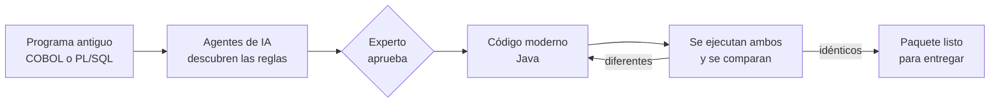

# CodePhoenix — Resumen ejecutivo

*Documento para negocio, dirección y jurado. No requiere conocimientos técnicos.*

## El problema

Bancos y aseguradoras siguen operando sus procesos más críticos —créditos, pólizas, siniestros— sobre
programas escritos hace décadas en COBOL o PL/SQL. Funcionan, pero:

- **Nadie sabe exactamente qué hacen.** La documentación original ya no refleja años de parches: la única
  verdad está en el código.
- **Quedan pocos expertos** capaces de leerlos, y cada vez son más caros.
- **Modernizarlos es lento y arriesgado.** Entender a mano una sola rutina puede llevar semanas, y un
  redondeo mal traducido produce diferencias de dinero en producción.

## La solución

CodePhoenix es un **copiloto de modernización**: un equipo de agentes de inteligencia artificial que lee el
programa antiguo, descubre sus reglas de negocio, las presenta a un experto para que las apruebe y genera
el programa moderno equivalente en Java.

Lo que lo diferencia es que **no pide confianza: entrega pruebas**. CodePhoenix ejecuta el programa
original y el nuevo con los mismos datos y compara los resultados, centavo a centavo. Si no coinciden,
la migración no se entrega.

## Cómo funciona, en 8 pasos

| Paso | Qué ocurre | Por qué importa |
|---|---|---|
| 1. Carga | Se sube el programa. Las contraseñas y datos personales se ocultan antes de que la IA lo vea. | Ningún secreto sale de la organización. |
| 2. Análisis | Se mapea la estructura del programa: qué partes hay, cuáles se usan, cuáles son riesgosas. | Se detecta código muerto que no hay que migrar. |
| 3. Reglas | La IA redacta las reglas de negocio en lenguaje claro, cada una con su ubicación exacta en el código. | El conocimiento oculto se vuelve documentación auditable. |
| 4. Aprobación | Un experto revisa cada regla: la aprueba, la ajusta o la rechaza. | Ninguna decisión de negocio queda en manos de la IA. |
| 5. Diseño | Se diseña la arquitectura moderna. | El resultado es mantenible y apto para la nube. |
| 6. Generación | La IA escribe el código nuevo y se corrige sola hasta que compila sin problemas de calidad ni de seguridad. | Código limpio, sin vulnerabilidades críticas. |
| 7. Verificación | Se ejecutan el programa original y el nuevo con los mismos casos y se comparan; además, cientos de pruebas automáticas. | Prueba objetiva de que el nuevo sistema hace lo mismo. |
| 8. Entrega | Se arma un paquete con código, pruebas, documentación, reportes e informe ejecutivo. | Listo para el equipo técnico, negocio y auditoría. |

## Resultados demostrados

Con dos programas de ejemplo realistas (un cálculo de cuotas de crédito en COBOL y una liquidación de
siniestros en PL/SQL):

| Indicador | Resultado |
|---|---|
| Tiempo de extremo a extremo | **6–7 minutos** por programa (más el tiempo de revisión del experto) |
| Reglas de negocio descubiertas | **15–16 por programa**, cada una enlazada a sus líneas de código |
| Equivalencia con el programa original | **100 % de los casos idénticos** |
| Pruebas automáticas generadas | **150–200 por programa**, todas aprobadas |
| Escenarios en lenguaje de negocio ejecutados como pruebas | **30–50 por programa**, cubren el 100 % de las reglas |
| Código cubierto por pruebas | **> 95 %** |
| Vulnerabilidades críticas | **0** |
| Contraseñas expuestas a la IA | **0** |

Además, el copiloto encontró un **defecto oculto** del programa COBOL: en un caso extremo (crédito a 30 años
con la tasa máxima) el saldo se vuelve negativo y el sistema antiguo lo muestra como positivo. El código
nuevo reproduce ese comportamiento —porque debe ser equivalente— y lo deja documentado para que negocio
decida si corregirlo.

## Beneficios

- **Semanas → minutos.** El análisis y la migración de una rutina pasan de semanas de trabajo experto a
  minutos de proceso automático más la revisión humana.
- **Menos dependencia de especialistas escasos.** Cada regla queda explicada en español y en escenarios
  ejecutables que un analista de negocio puede leer.
- **Riesgo controlado.** La equivalencia se demuestra con el sistema real, no se supone.
- **Auditoría completa.** Cada regla, cada decisión de diseño y cada uso de la IA queda registrado.

## Uso responsable de la IA

- La IA nunca ve contraseñas ni datos personales: se ocultan antes.
- Solo se usan datos de prueba ficticios.
- Un experto humano aprueba todas las reglas antes de que se genere código.
- Cada consulta a la IA queda registrada (qué agente, cuándo, cuánto consumió), sin guardar su contenido.
- Los programas se ejecutan en entornos aislados sin acceso a Internet.

## Alcance actual y próximos pasos

| Hoy | Siguiente |
|---|---|
| COBOL y PL/SQL | RPG y Java antiguo |
| Destino Java 21 | Node.js/TypeScript y C# .NET |
| Un programa por migración | Proyectos con varios programas y librerías compartidas (copybooks, paquetes) |
| Datos de prueba diseñados por IA | Casos tomados (anonimizados) de producción |
