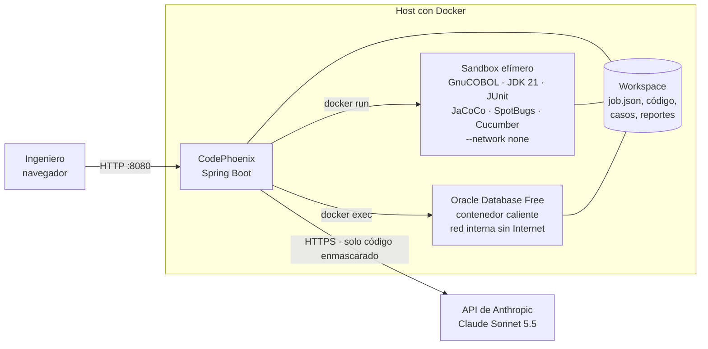
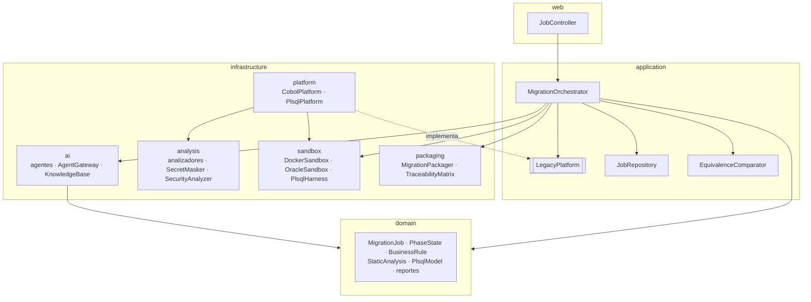
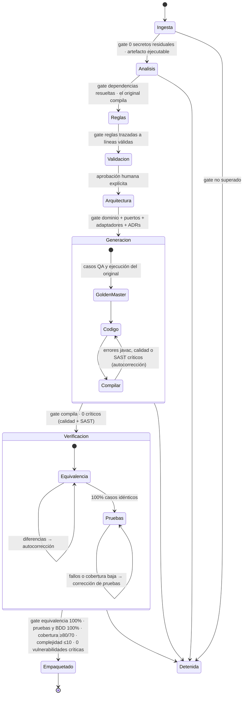
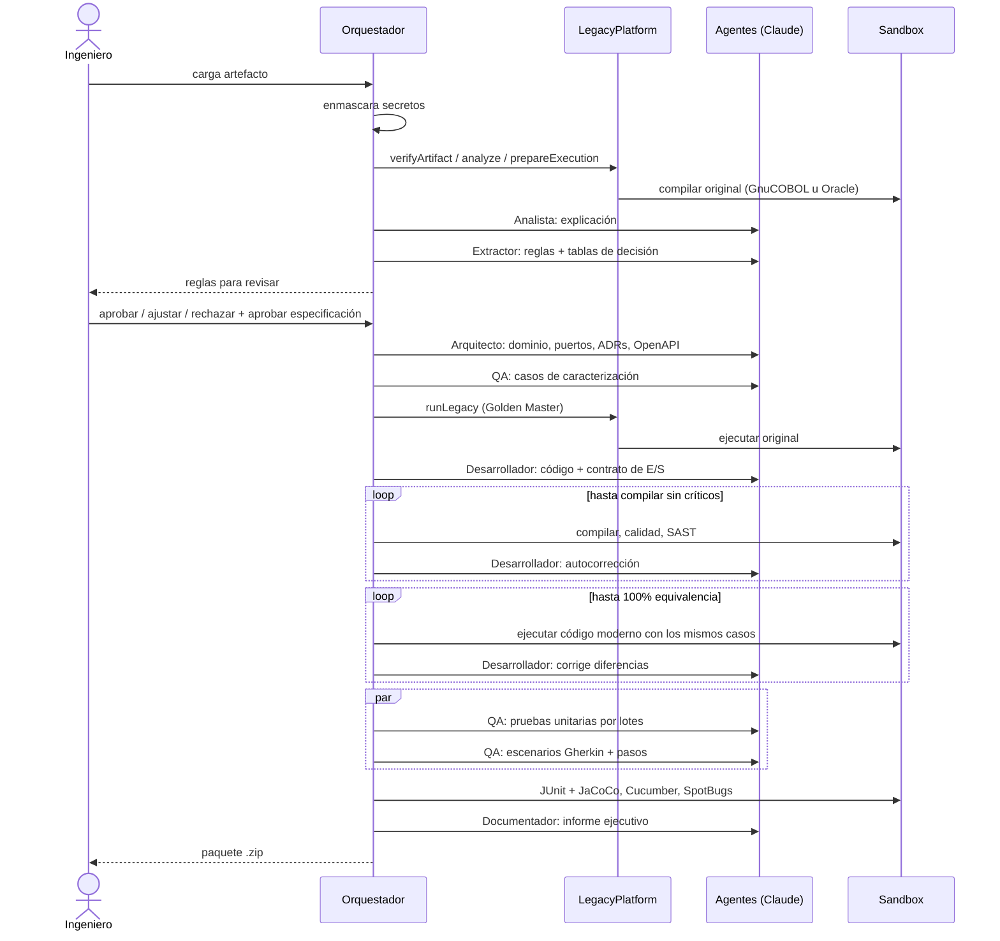
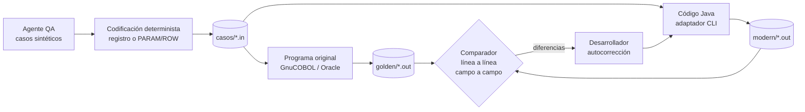
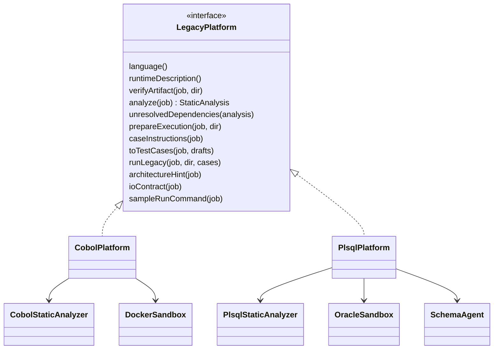

# CodePhoenix — Arquitectura técnica

*Documento para desarrolladores, arquitectos y evaluadores técnicos.*

## 1. Vista general

CodePhoenix es una aplicación **Spring Boot 4 + Spring AI 2** (Java 21) que orquesta agentes de Claude y dos
sandboxes Docker para migrar programas legacy a Java con equivalencia funcional demostrada.



| Elemento | Tecnología | Responsabilidad |
|---|---|---|
| Portal web | HTML + JavaScript sin framework (`static/`) | Flujo guiado, revisión de reglas, vista comparativa, tablero |
| API REST | Spring MVC (`web`) | Iniciar migraciones, decidir reglas, aprobar, descargar paquete |
| Orquestador | `MigrationOrchestrator` | Máquina de estados de 8 fases con quality gates |
| Agentes | Spring AI `ChatClient` (`infrastructure.ai`) | Analista, Extractor, Arquitecto, QA, Desarrollador, Documentador, Analista de datos |
| Análisis estático | Java puro (`infrastructure.analysis`) | Parsers COBOL y PL/SQL, enmascarador, calidad Java, SAST |
| Sandboxes | Docker (`infrastructure.sandbox`) | Ejecutar el original (Golden Master), compilar y probar el código generado |
| Persistencia | JSON en disco (`JobRepository`) | Sobrevivir a reinicios; reabrir migraciones sin conexión |

## 2. Capas y paquetes



| Paquete | Contenido |
|---|---|
| `domain` | Estado de la migración y sus artefactos. Sin dependencias de Spring salvo anotaciones de serialización. |
| `application` | Orquestación, puerto `LegacyPlatform`, comparador de equivalencia, repositorio. |
| `infrastructure.platform` | Una implementación de `LegacyPlatform` por lenguaje (patrón Strategy). |
| `infrastructure.ai` | Agentes, gateway hacia el modelo y base de conocimiento. |
| `infrastructure.analysis` | Análisis deterministas (no usan IA). |
| `infrastructure.sandbox` | Ejecución aislada en Docker. |
| `infrastructure.packaging` | Paquete de entrega y matriz de trazabilidad. |

## 3. Flujo de 8 fases



El flujo se ejecuta en dos tramos en hilos virtuales: **descubrimiento** (fases 1–3) y **entrega**
(fases 5–8). Entre ellos el job queda en `ESPERANDO_APROBACION` hasta que el ingeniero decide cada regla y
aprueba la especificación (`POST /api/jobs/{id}/approve`).

## 4. Secuencia de agentes



## 5. Cómo se demuestra la equivalencia



- El código generado incluye un **adaptador CLI de caracterización** que habla el mismo "idioma" de entrada y
  salida que el original. Ese contrato lo define cada plataforma (`LegacyPlatform.ioContract`).
- El comparador ignora el relleno de espacios dentro de cada campo (`|`) pero no los valores.
- En PL/SQL las filas de tablas (`ROW|...`) se comparan como conjunto, porque Oracle no garantiza su orden.

### Contrato COBOL

Un registro de ancho fijo por caso, igual al que lee el `ACCEPT`. El agente QA da valores por campo y
CodePhoenix lo codifica según el `PIC` (decimales implícitos, ceros a la izquierda). La salida es todo lo que
emite el programa con `DISPLAY`.

### Contrato PL/SQL

```
Entrada                                  Salida
PARAM|P_SINIESTRO_ID|1001                OUT|P_MONTO_PAGAR|10661.1
ROW|POLIZAS|POLIZA_ID=1|ESTADO=VIGENTE   OUT|P_ESTADO|LIQUIDADO
ROW|SINIESTROS|SINIESTRO_ID=1001|...     ROW|PAGOS_SINIESTRO|SINIESTRO_ID=1001|MONTO=10661.1|...
                                         ROW|SINIESTROS|...|ESTADO=LIQUIDADO|...
```

`PlsqlHarness` convierte cada caso en un script SQL*Plus que limpia las tablas, inserta las filas, invoca la
rutina con notación nombrada, imprime los parámetros `OUT` o `ERR|SQLCODE|mensaje`, y vuelca el estado final
de las tablas que la rutina modifica. Números sin ceros sobrantes, fechas `yyyy-MM-dd HH:mm:ss`, nulo `\N`.

## 6. Soporte de lenguajes (patrón Strategy)



Para añadir un lenguaje (por ejemplo RPG) se implementa `LegacyPlatform` como `@Component`, se ajusta
`LanguageDetector` y se añade su documento de semántica a `resources/knowledge`. El orquestador, los
agentes y los quality gates no cambian.

## 7. Agentes

| Agente | Fase | Entrada principal | Salida | Perfil (esfuerzo / tokens) |
|---|---|---|---|---|
| Analista | 2 | Código enmascarado + análisis estático | Explicación en lenguaje natural | bajo / 6k |
| Analista de datos | 2 (PL/SQL) | Código + tablas sin DDL | DDL inferido + supuestos | medio / 20k |
| Extractor de reglas | 3 | Código numerado + análisis + base de conocimiento | Reglas, tablas de decisión, lógica de infraestructura | medio / 20k |
| Arquitecto | 5 | Especificación aprobada + pistas de la plataforma | Elementos DDD, ADRs, OpenAPI, diagrama | medio / 20k |
| QA | 6 | Reglas + formato de casos | Casos de caracterización | medio / 20k |
| Desarrollador | 6–7 | Reglas + Golden Master + contrato de E/S | Código Java; correcciones | alto / 32k |
| QA (pruebas) | 7 | Código + Golden Master | Pruebas JUnit 5 por lotes; escenarios Gherkin + pasos | medio / 32k |
| Documentador | 8 | Métricas verificadas | Informe ejecutivo | bajo / 6k |

`AgentGateway` es el único punto de salida hacia el modelo: aplica el perfil, descarta los bloques de
razonamiento, detecta respuestas truncadas, guarda la respuesta cruda en `ai-responses/` y registra en la
auditoría el hash SHA-256 del prompt, los tokens y la duración.

La **base de conocimiento** (`resources/knowledge`) aporta a los agentes la semántica exacta de cada lenguaje
(truncamiento vs. redondeo, campos sin signo, NULL en Oracle…), los estándares de código y un glosario
bancario y asegurador.

## 8. Quality gates

| Fase | Criterio | Umbral |
|---|---|---|
| 1 | Secretos residuales en el código enviado a la IA | 0 |
| 1–2 | El original compila (GnuCOBOL / Oracle) | sí |
| 2 | Dependencias sin resolver | 0 |
| 3 | Reglas con líneas de origen válidas | 100 % |
| 4 | Reglas decididas por el ingeniero | 100 % |
| 6 | Compilación; hallazgos bloqueantes o críticos (calidad + SAST) | 0 |
| 7 | Casos de equivalencia idénticos | 100 % |
| 7 | Pruebas unitarias aprobadas | 100 % |
| 7 | Escenarios BDD aprobados y reglas cubiertas por escenarios | 100 % |
| 7 | Cobertura de líneas / ramas | ≥ 80 % / ≥ 70 % |
| 7 | Complejidad ciclomática por método | ≤ 10 |
| 7 | Vulnerabilidades críticas (SpotBugs + FindSecBugs) | 0 |

### Análisis de calidad propio (`JavaQualityAnalyzer`)

Precisión decimal (sin `double`/`float` en dominio y aplicación), `BigDecimal` desde cadena, dependencias de la
arquitectura hexagonal (el dominio no importa adaptadores ni E/S), secretos en el código, `catch` vacíos,
`printStackTrace`, complejidad y longitud de métodos.

### SAST (`SecurityAnalyzer`)

SpotBugs 4.8.6 con FindSecBugs 1.13.0 sobre el bytecode, dentro del sandbox. Son críticos los hallazgos de la
categoría SECURITY de prioridad alta o media y los de CORRECTNESS de prioridad alta. También se verifica que
el código de producción no tenga dependencias de terceros.

## 9. Seguridad del proceso

| Riesgo | Control |
|---|---|
| Secretos enviados a la IA | `SecretMasker` enmascara credenciales, cadenas de conexión, claves de API, correos, IPs y tarjetas (Luhn) antes de cualquier llamada; se verifica que no queden residuos. |
| Secretos persistidos | `job.json` y el paquete solo contienen la versión enmascarada; el original queda en `workspace/jobs/<id>/legacy/` (excluido de git). |
| Código generado malicioso o defectuoso | Se ejecuta solo en contenedores efímeros sin red, con límites de memoria, CPU y procesos. |
| Base de datos expuesta | Oracle vive en una red Docker `--internal`: tiene IP privada pero ninguna ruta a Internet. Un usuario y esquema nuevos por ejecución. |
| Trazabilidad del uso de IA | Bitácora por llamada: agente, modelo, hash del prompt, tokens, duración, resultado. |

## 10. Persistencia

Cada migración se serializa como `JobSnapshot` en `workspace/jobs/<id>/job.json` (escritura atómica, cada 2 s
si cambió). Al arrancar, `JobRepository` las recupera: las completadas se reabren tal cual, las que esperaban
aprobación pueden continuar y las que estaban en curso se marcan como detenidas.

## 11. API REST

| Método | Ruta | Uso |
|---|---|---|
| GET | `/api/status` | Disponibilidad de los sandboxes |
| GET | `/api/samples`, `/api/samples/{id}` | Ejemplos incluidos |
| POST | `/api/jobs` | Iniciar migración `{sourceName, code, domainName, targetStack, caseInputs}` |
| GET | `/api/jobs`, `/api/jobs/{id}` | Listado y estado completo |
| POST | `/api/jobs/{id}/rules/{ruleId}` | Decisión `{decision: APROBAR\|AJUSTAR\|RECHAZAR, comment, ...}` |
| POST | `/api/jobs/{id}/approve` | Aprobar la especificación y continuar |
| GET | `/api/jobs/{id}/package` | Descargar el paquete `.zip` |

## 12. Configuración

| Propiedad | Por defecto | Descripción |
|---|---|---|
| `spring.ai.anthropic.chat.options.model` | `claude-sonnet-5-5` | Modelo de los agentes |
| `codephoenix.workspace` | `./workspace` | Carpeta de trabajo |
| `codephoenix.sandbox.image` | `codephoenix-sandbox:2` | Imagen del sandbox |
| `codephoenix.sandbox.volume` | vacío | Nombre del volumen compartido cuando CodePhoenix corre en Docker |
| `codephoenix.oracle.*` | ver `application.yaml` | Imagen, contenedor, red interna, arranque anticipado y tiempos |
| `codephoenix.max-correction-attempts` | `3` | Intentos de autocorrección por fase |
| `codephoenix.manual-estimate.*` | 12 LOC/h, US$45/h | Supuestos de la comparación con el proceso manual |

## 13. Paquete entregado

```
paquete-migracion-<id>.zip
├── src/main/java/…            código hexagonal (domain, application, adapter)
├── src/test/java/…            pruebas JUnit 5, pasos de Cucumber y RunCucumberTest
├── src/test/resources/features  escenarios Gherkin etiquetados @R-xx
├── legacy/                    original enmascarado (+ ESQUEMA.sql en PL/SQL)
├── docs/                      reglas y tablas de decisión, trazabilidad, arquitectura, ADRs, OpenAPI
├── reports/                   equivalencia, calidad, seguridad, pruebas, cobertura, auditoría de IA, Golden Master
├── Dockerfile · build.gradle  `docker build` compila y ejecuta pruebas + BDD
├── README.md
└── INFORME_EJECUTIVO.md
```

## 14. Limitaciones conocidas

- Un artefacto por migración: COBOL con `COPY` (copybooks), archivos VSAM o `EXEC SQL` no se ejecutan en el
  sandbox; los paquetes PL/SQL se analizan pero solo se ha probado de extremo a extremo con procedimientos.
- El análisis estático se basa en patrones, no en un árbol sintáctico completo.
- Las secuencias de Oracle no se reinician entre casos; las funciones no deterministas (`SYSDATE`) se
  advierten pero pueden hacer variar el Golden Master.
- Solo Java 21 como destino.
